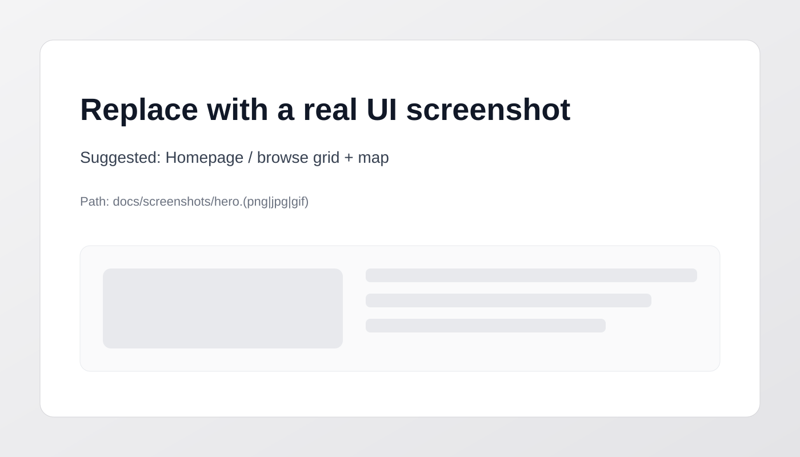
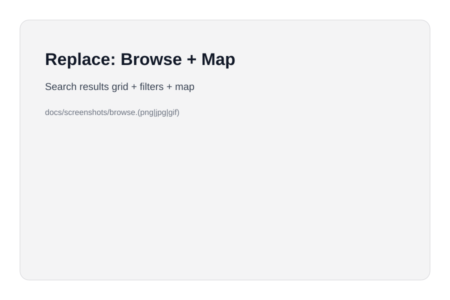
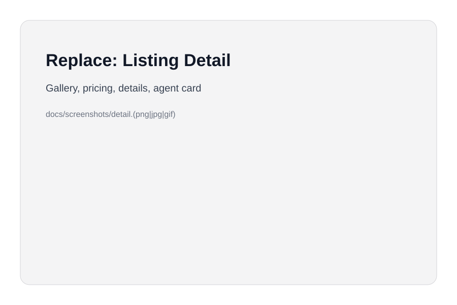
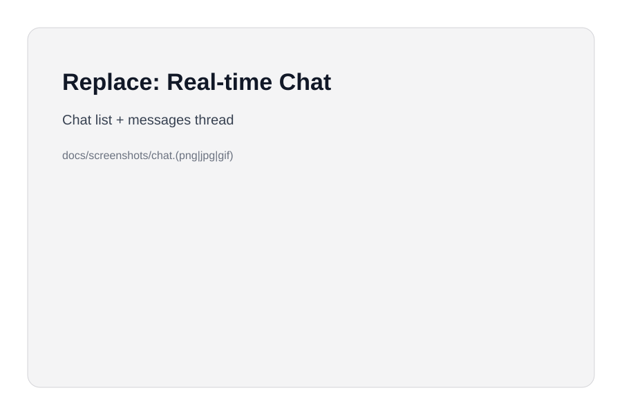

# UrbanLuxe — Full‑Stack Real Estate Marketplace (React + Express + Prisma + Socket.IO)

[](https://github.com/gautamprabhu07/Real-estate/actions/workflows/ci.yml)

A full‑stack real estate marketplace for renters/buyers and agents—featuring map-based discovery, saved listings, and real-time chat, backed by secure, cookie-based JWT auth and a Prisma + MongoDB data model.

<!-- Replace the image below with a clean hero screenshot (homepage, property grid + map, or your main user flow). Recommended size: ~1400×800. -->
<p align="center">
  
</p>

## Demo

- Live App: **REPLACE_ME**
  - <!-- Replace with your deployed frontend URL (e.g., Vercel/Render). Use the production domain. -->
- API Base URL: **REPLACE_ME**
  - <!-- Replace with your deployed API base URL (e.g., https://your-api.com/api). -->
- Realtime Socket URL: **REPLACE_ME**
  - <!-- Replace with your Socket.IO server URL. -->

<!-- Replace with 1–3 real screenshots showing: (1) browse/search, (2) listing details, (3) chat or profile/saved posts. -->

| Browse + Map                           | Listing Detail                         | Real-time Chat                     |
| -------------------------------------- | -------------------------------------- | ---------------------------------- |
|  |  |  |

## My Role

**Role:** Solo developer (end-to-end ownership)

- Product & UX: property browsing, listing details, saved listings, user profile flows
- Backend: API design, auth, authorization, data modeling, Prisma queries
- Realtime: Socket.IO event design + online user tracking
- Deployment: separate services for client / API / socket server

## Problem → Solution → Impact

### Problem

- Real estate discovery is fragmented: users need fast search, location context (map), and a way to coordinate (chat) without leaving the platform.
- A practical marketplace needs **secure auth**, **ownership controls**, and a **data model** that supports listings + messaging.

### Solution

- Built a full-stack marketplace with:
  - Map-first browsing (Leaflet) + filterable listing search
  - Auth via **httpOnly cookies** using **JWT**
  - Saved listings (many-to-many) and profile dashboards
  - Real-time chat using a dedicated Socket.IO service
  - Strong persistence layer with **Prisma + MongoDB** schema modeling

### Impact (Scope & Realism)

- Multi-feature system spanning: listings, details, saved posts, chat, profile updates
- Real-time messaging flow designed for online/offline recipients
- Production-style concerns: password hashing, protected routes, ownership checks, CORS + credentialed cookies

## Key Engineering Decisions

- **JWT in httpOnly cookies** instead of localStorage tokens to reduce XSS token theft risk and support cross-site cookie configuration (`SameSite=None`, `secure`).
- **Prisma + MongoDB** to keep a typed schema, consistent relations (posts/details/saves/chats/messages), and query ergonomics while using a document DB.
- **Service separation for realtime** (Socket.IO server independent from the REST API) to keep responsibilities clear and scale independently.
- **Authorization at the resource level** (e.g., only owners can update/delete their posts; only chat participants can read/send messages).
- **Predictable routing structure** (`/api/auth`, `/api/posts`, `/api/chats`, `/api/messages`, `/api/users`) for maintainability and clean client integration.

## Features

- Listings
  - Create/update/delete posts (protected)
  - Listing detail with agent info + saved-state
  - Filters: city, buy/rent, property type, bedrooms, price range
- Accounts
  - Register/login/logout
  - Profile updates (including avatar URL)
  - Saved listings (toggle save/unsave)
- Chat
  - Create chat, fetch chats, mark as read
  - Send messages via REST + deliver in realtime via Socket.IO

## Tech Stack

- **Frontend:** React (Vite), React Router, Zustand, Sass, Leaflet/React-Leaflet, Axios
- **Backend:** Node.js, Express, Prisma Client
- **Database:** MongoDB (Prisma datasource)
- **Auth & Security:** bcrypt password hashing, JWT, httpOnly cookies, CORS w/ credentials
- **Realtime:** Socket.IO (server + client)

## Backend Notes (Depth)

- **Auth middleware:** protected routes validate cookie token and attach `req.userId`.
- **Ownership checks:** update/delete listing endpoints verify the authenticated user owns the resource.
- **Messaging integrity:** message creation validates chat membership before writing.
- **Data model:** posts include `PostDetail`; `SavedPost` uses a composite unique constraint to prevent duplicates.

## Repo Structure

- `client/` — React app (Vite)
- `api/` — Express REST API + Prisma schema
- `socket/` — Socket.IO server (realtime delivery)

## Local Setup (Short)

Each service has an `.env.example` documenting its required variables — copy it to `.env` and fill in real values; nothing needs editing in source files.

### 1) API

```bash
cd api
npm install
cp .env.example .env   # fill in DATABASE_URL and JWK
npx prisma db push     # create collections/indexes in your MongoDB database
npm run seed           # optional: populate demo users, listings, a chat
node app.js
# or (if you prefer autoreload)
# npx nodemon app.js
```

API runs on `http://localhost:8800`. `CLIENT_URL` in `api/.env` controls the CORS allow-origin — set it to wherever the client is actually running (`http://localhost:5173` for local dev).

### 2) Socket Server

```bash
cd socket
npm install
cp .env.example .env   # CLIENT_URL + PORT, both already default to local values
node app.js
```

Socket server runs on `http://localhost:4000` by default (`PORT` in `.env`).

### 3) Client

```bash
cd client
npm install
cp .env.example .env   # VITE_API_URL + VITE_SOCKET_URL default to the local API/socket above
npm run dev
```

No source edits needed for local vs. production — `apiRequest.js` and `SocketContext.jsx` both read their target URLs from these env vars (falling back to `http://localhost:8800/api` / `http://localhost:4000` if unset).

### Production Deployment Notes (Render/Vercel-style)

- Each service (`api/`, `socket/`, `client/`) deploys independently — set its env vars in the hosting dashboard rather than committing a `.env`.
- **API service:** set `DATABASE_URL`, `JWK`, `CLIENT_URL` (your deployed frontend's URL), and **`NODE_ENV=production`** — the last one is required for the auth cookie to be sent as `Secure; SameSite=None`, which cross-site cookies need in production (and which must be *off* for local HTTP dev, which is why it isn't hardcoded).
- **Socket service:** set `CLIENT_URL` to the same deployed frontend URL; `PORT` is usually injected automatically by the host.
- **Client:** set `VITE_API_URL` and `VITE_SOCKET_URL` to the deployed API/socket URLs at build time (Vite env vars are baked in at build, not read at runtime).

## API (High-Level)

- `POST /api/auth/register` — create account
- `POST /api/auth/login` — login (sets cookie)
- `POST /api/auth/logout` — clear cookie
- `GET /api/posts` — list with filters
- `POST /api/posts` — create (auth)
- `PUT /api/posts/:id` — update (auth + ownership)
- `DELETE /api/posts/:id` — delete (auth + ownership)
- `GET /api/chats` — list user chats (auth)
- `POST /api/messages/:chatId` — send message (auth)

## What I Learned

- Designing **authorization boundaries** that match real product rules (ownership + membership)
- Modeling relational behavior on MongoDB using **Prisma relations** + unique constraints
- Handling cross-site auth correctly with **CORS + credentialed cookies**
- Building realtime delivery with **Socket.IO** while keeping REST as the source of truth

## Future Improvements

- Add request validation (e.g., Zod/Joi) + centralized error handling
- Rate limiting + audit logging for auth endpoints
- Tests (API integration + critical auth/ownership flows)
- CI checks (lint/test) and environment-based config (avoid hard-coded URLs)

## Contact

- Name: **REPLACE_ME**
- LinkedIn: **REPLACE_ME**
- Portfolio: **REPLACE_ME**

<!-- Tip: Add a short “About Me” sentence here aligned with roles you want (Backend / Full-stack / SWE). -->
